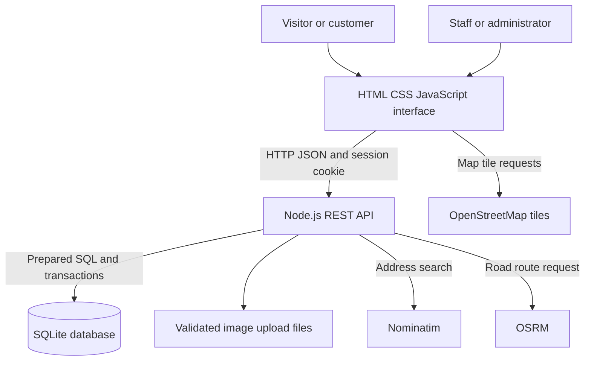
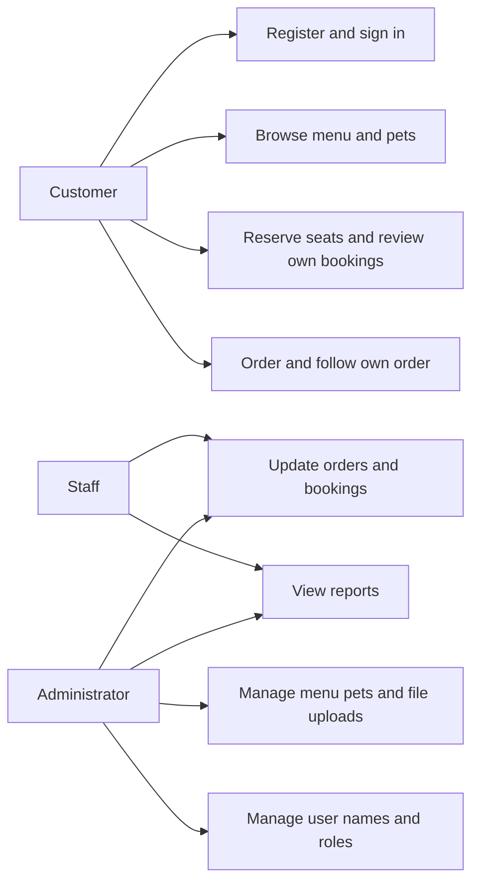
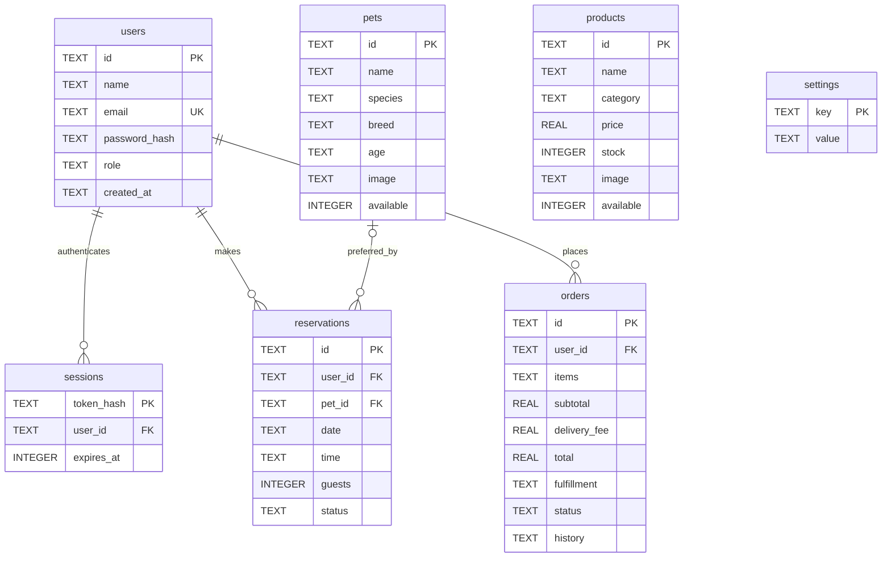

# Cake Galerie Pet Café Reservation and Ordering System

**Final Integrative Programming & Technologies 1 Project**  
School: [complete]  
College / Department: [complete]  
Group members: [complete]  
Section: [complete]  
Instructor: [complete]  
School year: [complete]

This editable documentation follows the supplied nine-chapter outline. Fill in the school/team details, record the team's actual test results, and add screenshots before academic submission. The content describes the delivered system rather than an existing café's internal practices.

For the required printed copy, place this content in an A4 document using Times New Roman 12 pt, 14–16 pt bold headings, 1.5 spacing, justified paragraphs, a 1.25-inch left margin and 1-inch remaining margins, and bottom page numbers. Export the final reviewed document to PDF. This Markdown file itself does not enforce print formatting.

## Chapter 1 – Introduction

### 1.1 Background

The project combines a pet café's booking workflow with a small online shop. Customers can browse a menu, reserve a one-hour café visit, choose a pet preference, order food for pickup or delivery, and review progress from one interface. Staff can update those records through a management dashboard. The application uses a JavaScript REST API and SQLite database, with public map, geocoding, and routing services supplying external data.

The design is an independent educational concept using the name Cake Galerie. Genuine Studio Ghibli film stills set the visual theme. Neither the café nor Studio Ghibli commissioned or endorsed the project. Sample menu prices, pet profiles, operating rules, and the café map point are demonstration data.

### 1.2 Problems addressed

1. Separate manual lists make guest reservations difficult to coordinate.
2. Customers need one place to view available menu items and submit an order.
3. Staff need a common record of order progress and delivery destinations.
4. Menu, stock, and pet information need controlled updates.
5. Different account roles need appropriate access to customer and management records.

These are problems addressed by the project scenario, not findings from a formal study of the real Cake Galerie business.

### 1.3 Objectives

1. Provide customer registration, login, and role-based management access.
2. Implement create, read, update, and delete operations for menu and pet records.
3. Store shared users, bookings, catalog records, and orders in a relational database.
4. Expose a documented HTTP/JSON REST API.
5. Integrate OpenStreetMap tiles, Nominatim address search, and OSRM road routes.
6. Validate bookings, delivery coordinates, stock, uploads, and permissions.
7. Provide customer histories and staff operational summaries.

### 1.4 Scope and limitations

The full Node server supports shared data, server sessions, image file uploads, bookings, ordering, stock changes, role management, reports, and map integrations. Reservations share 16 guest seats per one-hour slot, Wednesday–Saturday from noon through 18:00, ending at 19:00 Philippine time. Selecting a pet expresses a preference and does not reserve an animal exclusively. Delivery is available within a configured 15 km straight-line radius, with a flat ₱60 fee.

Payment is cash on delivery or at pickup. Rider location is manually entered by staff; there is no continuous GPS feed or rider app. The system does not implement payment processing, password recovery, email verification, SMS, refunds, multi-branch support, or comprehensive pet care scheduling. Public map services require internet access and may be unavailable or rate-limited. Sample film imagery is illustrative and should be replaced through uploads where actual product or pet identification is required.

The included GitHub Pages version is a browser-local demonstration. It stores records in `localStorage`, supplies illustrative login accounts, and does not provide a shared database or secure authentication. It cannot be used as evidence of backend integration; run the Node server for that part of the project.

## Chapter 2 – System Requirements

### 2.1 Users

| Role | Functions |
|---|---|
| Visitor | Browse menu and pet profiles; inspect café information; register or sign in |
| Customer | Place and review own orders; reserve seats; view own bookings; cancel eligible own transactions |
| Staff | Review all orders/reservations; advance fulfillment; manually enter rider location; complete/cancel bookings; view reports |
| Administrator | Staff functions plus catalog CRUD, image uploads, and user name/role management |

### 2.2 Functional requirements

| No. | Requirement | Delivered component |
|---|---|---|
| 1 | Login and registration | Auth forms, cookie sessions, password hashes |
| 2 | Create/read/update/delete records | Admin menu and pet screens, REST endpoints |
| 3 | Search and filter | Customer menu filters and management list controls |
| 4 | Reserve a café session | Availability query and transactional capacity check |
| 5 | Submit a shopping order | Cart, pickup/delivery checkout, stock transaction |
| 6 | Upload pictures from files | Local file picker, preview, validated server upload |
| 7 | Display external data | Map tiles, address candidates, route line and estimates |
| 8 | Track progress | Timestamped order status and staff-entered rider coordinates |
| 9 | View reports | Counts, completed-order revenue, low-stock list |
| 10 | Preserve shared records | SQLite tables, foreign keys, transactions |
| 11 | Enforce permissions | Server role/ownership checks and restricted UI |
| 12 | Handle invalid requests | JSON errors and meaningful HTTP status codes |

### 2.3 Technologies used

| Technology | Purpose |
|---|---|
| HTML5 | Page structure, forms, semantic controls |
| CSS | Responsive layouts, styling, and image cropping |
| Vanilla JavaScript ES modules | Interface state, JSON requests, browser demo, mapping |
| Node.js 24+ built-in HTTP, crypto, filesystem modules | JavaScript API server, sessions, hashing, uploads |
| Node `node:sqlite` / SQLite | Relational persistence, prepared statements, transactions |
| JSON / HTTP | Frontend/API and external service communication |
| Leaflet 1.9.4 | Interactive maps; bundled locally |
| OpenStreetMap, Nominatim, OSRM | Map tiles, address lookup, road routing |
| Node test runner | Automated integration checks |
| GitHub / GitHub Actions / GitHub Pages | Source hosting and static demo deployment |

An API client such as Postman or browser developer tools can be used for manual verification; record the tool actually used in the submission appendix.

## Chapter 3 – System Design

### 3.1 System architecture



The Node server serves the frontend and API together by default. The Pages demo replaces the API client with a browser store and must be labeled as a demonstration. A separately hosted frontend may connect to an HTTPS API through the configuration file and an exact allowed origin; browser cookie restrictions can affect that arrangement.

### 3.2 Use cases



### 3.3 Database design

The database is `data/cafe.sqlite` by default. SQL definitions are created by `server.mjs`; that file is the authoritative schema. Foreign keys are enabled. Journal mode is WAL and the busy timeout is five seconds.



The ERD shows keys and principal fields; the SQL also includes descriptions, notes, timestamps, contact information, and delivery/rider coordinates where appropriate.

| Table | Purpose and constraints |
|---|---|
| `users` | Unique email, password hash, and role constrained to admin/staff/customer |
| `sessions` | Hashed session token and expiry; user foreign key with delete cascade |
| `products` | Menu catalog; nonnegative prices/stock and boolean availability |
| `pets` | Pet profile data and availability |
| `reservations` | User FK, optional pet FK, slot, guests (API 1–6; database guard 1–16), constrained status |
| `orders` | User FK; fulfillment, totals, contact/destination/tracking fields; item and status-history snapshots as JSON text |
| `settings` | Seed initialization marker |

Order `items` and `history` are deliberately stored as JSON snapshots in the order row. The project does not include an `order_items` table or SQL product foreign keys inside these snapshots. The application validates product IDs when ordering and retains historical names/prices even after catalog changes. A future normalized analytics design could extract an order-detail table. Indexes support reservation slot capacity lookups and orders by user.

## Chapter 4 – System Development

### 4.1 Login

**Purpose:** identify a user and establish authorized access. **Input:** email and password, plus name for registration. **Process:** validate input, find the account, derive a password hash with scrypt and a per-password random salt, compare securely, and create a random session. **Output:** a user resource and HttpOnly session cookie. Only a hash of the session token is stored in SQLite; server sessions expire after seven days. Production cookies are marked Secure. Failed sign-in attempts are throttled.

Customers register with the customer role. The first administrator is bootstrapped using environment variables and is not assigned a public default password. Administrators can promote an existing account to staff. Server authorization checks protect each restricted operation; hiding a button is not the permission boundary.

### 4.2 Main modules

| Module | Process |
|---|---|
| Catalog | Fetch products, filter categories, and show stock/availability |
| Pet profiles | Display sample companion details and availability |
| Reservations | Request slot capacity, validate a future booking, atomically reserve guest seats |
| Cart and checkout | Submit product IDs/quantities; server computes prices/fees and deducts stock |
| Order tracking | Read status history and last staff-entered rider position |
| Administration | Restricted menu/pet CRUD, user management, and transaction updates |
| Uploads | Read a selected file, validate size/signature/type, write a generated filename |
| Reports | Count records, sum completed orders, list low-stock products |
| Map integration | Display map tiles, query addresses, and draw estimated road routes |

### 4.3 Database connection and integrity

The server opens SQLite through Node's `DatabaseSync` and uses prepared statements with bound parameters. Startup creates the schema and seeds the catalog once. A `BEGIN IMMEDIATE` transaction groups stock checks, inventory deductions, and order insertion; failure rolls back the group. Booking capacity checks and insertion run in a transaction as well. Cancellation restores stock and closes the order once, preventing repeated cancellation from replenishing stock repeatedly.

Users with transaction history cannot be deleted. Pets referenced by bookings cannot be deleted; mark them unavailable instead. The last administrator and the current administrator account are protected from destructive role/account changes.

### 4.4 REST API and external services

Examples of the application's own endpoints:

```text
GET    /api/products
POST   /api/products
PUT    /api/products/{id}
DELETE /api/products/{id}
GET    /api/availability?date=YYYY-MM-DD
POST   /api/reservations
POST   /api/orders
PUT    /api/orders/{id}
GET    /api/geocode?q=address
GET    /api/route?lat=latitude&lng=longitude
```

The frontend serializes request objects with `JSON.stringify` and deserializes JSON responses. The server validates types, ranges, required fields, date formats, IDs, record ownership, and permissions. Errors use a short `error` property with HTTP status codes. External map calls have timeouts and friendly failure messages. Nominatim queries are cached and spaced to respect public-service limits. Full request/response documentation is in [API.md](API.md).

## Chapter 5 – Testing

Recorded verification on 16 October 2026: **44 automated tests/subtests passed, 0 failed** with Node.js 24.19.0 using real HTTP for backend integration. Customer registration, map-based delivery ordering, reservations, administrator file uploads for menu items and pets, manual delivery updates, and 390 px mobile layouts were also checked in a browser. See [TESTING.md](TESTING.md) for scope and evidence.

Run `npm run check` and `npm test` from the repository root. Automated tests are supplied under `tests/`; read their current names and assertions to explain what was verified. A successful automated run is not a substitute for browser testing, real external-service checks, or a user demonstration.

Use [TESTING.md](TESTING.md) for the test matrix and record actual results, environment, date, and evidence. Do not fill PASS before execution. Pay particular attention to authorization, capacity conflicts, stock rollback/cancellation, upload validation, order transition rules, and database persistence across restarts.

## Chapter 6 – User Manual

### 6.1 Registration and login

1. Open the site and select the sign-in control.
2. Register with your name, email, and a password of at least 10 characters, or sign in with an existing account.
3. Check that your signed-in name appears.
4. In the full server, administrators sign in with the credentials configured in `.env`. Browser demo accounts are listed in the README and are not server accounts.

### 6.2 Browse and order

1. Open the menu, choose a category or search for an item, and add available products to the cart.
2. Open the cart and adjust quantities.
3. Choose pickup or delivery and enter a contact number.
4. For delivery, enter a street address and select the destination on the map. Search an address or use location assistance if offered. Verify the pin yourself.
5. Review the order and delivery fee, then submit. Payment is cash on delivery or at pickup.
6. Open your orders to review the timeline. Customers can cancel an order only while it is newly placed.

### 6.3 Book a visit

1. Open the reservation form and choose an open future date.
2. Select a one-hour time slot and guest count that fits the remaining capacity.
3. Select a preferred pet or no preference, add optional notes, and confirm.
4. Review the reservation in your account. Cancel it if you can no longer attend. Pet selection is a preference, not a private animal session.

### 6.4 Add and edit menu items or pets

1. Sign in as an administrator and open the management dashboard.
2. Select the menu or pets section and choose the add action.
3. Fill in the record fields. Choose an image using the **file upload** control and check its preview.
4. Save and confirm the new record appears.
5. To edit, choose the record's edit action, change the fields, optionally select a replacement image, and save.
6. To delete, choose delete and confirm. If a pet has reservations, mark it unavailable instead.

### 6.5 Update transactions and rider position

1. Sign in as staff or administrator and open the orders section.
2. Advance a delivery through placed, preparing, out for delivery, and delivered. Pickup uses ready for pickup and collected instead.
3. While a delivery is out for delivery, enter the rider's last known latitude and longitude and save the tracking update.
4. Open reservations to complete or cancel a confirmed visit.

The rider marker represents the last manual entry. It does not receive continuous GPS updates. Customers see only their own records; the team dashboard shows all transactions.

### 6.6 Users and reports

Administrators open user management to edit a name or change a role. To create a staff account, register an account first, then promote it. Role changes end the changed user's sessions. Accounts linked to transactions cannot be deleted.

Staff and administrators open the dashboard reports to view counts, completed-order revenue, and low-stock items. Use the available search/filter controls to inspect records. The system provides an operational dashboard; a specialized accounting export is outside scope. Browser printing may be used for a temporary copy.

Included screenshot evidence: [customer home](screenshots/home.jpg), [mobile customer home](screenshots/home-mobile.jpg), and [mobile management](screenshots/management-mobile.jpg). For the final academic copy, add screenshots of login, checkout, bookings, tracking and reports from your own demonstration, with captions explaining the action shown. Do not include real passwords, cookies, or personal customer information.

## Chapter 7 – API Documentation

The complete endpoint reference is [API.md](API.md). It includes every implemented endpoint's HTTP method, access level, purpose, request, success response, and status code, as well as validation and error behavior. Test the Node endpoints with a cookie-aware API client; the Pages demo does not expose these server endpoints.

## Chapter 8 – Installation Guide

### 8.1 Requirements

Node.js 24+, npm, a modern browser, a writable local directory, and internet access for external map features. No database server, application framework, or runtime npm package installation is required.

### 8.2 Database setup

1. Copy `.env.example` to `.env` in the repository root.
2. Configure a unique administrator email and password of at least 12 characters.
3. Keep the default writable `DATA_DIR=./data`, or select another persistent directory.
4. On first startup, the server creates `cafe.sqlite` and imports the catalog seed once. SQL tables are defined in `server.mjs`.

### 8.3 Run the API and application

```sh
npm start
```

The start command loads `.env`. Open `http://localhost:3000`, sign in, and visit `/admin.html` for management. The same server serves both the frontend and `/api`. `GET /api/health` returns `{"ok":true}`. Run `npm run check` and `npm test`, then complete the manual checks.

### 8.4 Publish

For the static demo, upload the project to GitHub, select GitHub Actions as the Pages source, and run the included workflow. For the full shared system, deploy to a Node.js host with a persistent disk and HTTPS, configure environment variables, and run the same start command. Use one origin for UI/API when possible. Full details, configuration names, and the optional separate-API setup are in [README.md](../README.md).

GitHub Pages cannot host the Node process or SQLite database. Do not commit `.env`, database files, uploaded customer images, or live customer information. Maintain a backup of persistent application data and verify restoration before using the application operationally.

## Chapter 9 – Conclusion

### 9.1 Conclusion

The project implements a pet café reservation and ordering scenario with a vanilla HTML/CSS/JavaScript interface, a JavaScript REST API, SQLite storage, account roles, uploads, and external map services. It connects customer forms, management actions, HTTP/JSON communication, database transactions, and external responses into one application. The full server demonstrates integration; the static mode supplies a convenient portfolio demonstration with explicit storage and security limits.

The team should replace this paragraph with its own account of what it learned while reviewing and demonstrating the implementation. Appropriate topics include the distinction between authentication and authorization, server validation, API contracts, transaction integrity, external-service failure handling, and static versus server deployment.

### 9.2 Recommendations

Future work could add verified real café data and photos, normalized order-detail analytics, password recovery, email verification, notifications, payment-provider integration, a rider GPS app, pet welfare/rest scheduling, hosted map service capacity, accessibility testing with users, and a managed multi-instance database when scale requires it.

## References

- [Node.js 24 SQLite documentation](https://nodejs.org/docs/latest-v24.x/api/sqlite.html)
- [Node.js cryptography documentation](https://nodejs.org/docs/latest-v24.x/api/crypto.html)
- [SQLite foreign key documentation](https://www.sqlite.org/foreignkeys.html)
- [Leaflet documentation](https://leafletjs.com/reference.html)
- [OpenStreetMap attribution](https://www.openstreetmap.org/copyright)
- [Nominatim public service policy](https://operations.osmfoundation.org/policies/nominatim/)
- [OSRM API documentation](https://project-osrm.org/docs/v5.24.0/api/)
- [GitHub Pages documentation](https://docs.github.com/en/pages/getting-started-with-github-pages/what-is-github-pages)
- [Official film galleries and individual asset credits](ASSET-CREDITS.md)
- Instructor-provided *Final Integrative Programming & Technologies 1 Project* brief, supplied with the request.

## Appendices to complete before submission

- Browser screenshots with captions.
- API request/response evidence, with secrets removed.
- Database schema/table evidence and a persistence demonstration.
- Actual automated test output and the signed UAT matrix in [TESTING.md](TESTING.md).
- Team contribution log, evaluator comments, and any user acceptance forms.
